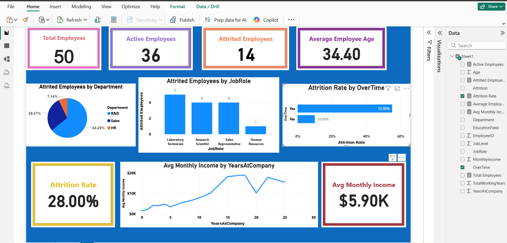

# Employee-data-analysis
Interactive Employee Attrition Analysis Dashboard built using Power BI to explore workforce trends, employee turnover and income metrics.
# Employee Data Analysis - HR Dashboard

An interactive Power BI dashboard designed to analyze employee attrition, workforce demographics, monthly income trends, and overtime impact.

## Dashboard Preview

## Key Metrics & Insights
* **Total Headcount:** 50 Employees (36 Active, 14 Attrited)
* **Overall Attrition Rate:** 28.00%
* **Average Employee Age:** 34.40 Years
* **Average Monthly Income:** $5.90K
* **Key Finding:** Employees working overtime experience a significantly higher attrition rate (55.00%) compared to non-overtime workers (10.00%).

## How to View
1. Download the `employees data analysis.pbix` file from this repository.
2. Open it in **Power BI Desktop** to interact with the full dashboard.
